# Agent plugins: the proxy's workflows as slash commands

llm-redact ships slash-command plugins for **Claude Code**, **Codex**,
**OpenCode**, and **Cursor** that put the proxy's ops workflows inside
the agent session itself: check the proxy's posture, watch recent
traffic, preview redaction, verify the audit chain, and make guarded
config edits — without leaving the tool the proxy is protecting. They
run on the free core's CLI and JSON endpoints; the browser dashboard
(config editor, redaction preview) that the right-hand column below maps
them to is part of llm-redact-pro and is not needed.

All four plugins carry the SAME eleven commands, defined once in
`src/llm_redact/plugin_assets.py` and rendered into each tool's command
format.

These are plugins for the agent tool. A separately installed Python package
(llm-redact-pro) extends the proxy itself through registry seams instead; the
one that decides which NER models may load, the model-load policy, is
described in [detection.md](detection.md#model-load-policies-plugins), and
the one that reads what the redaction scanned, scan sinks, in
[Scan sinks](#scan-sinks-a-registry-seam) below, and what a browser
dashboard may call on the proxy in
[The dashboard host](#the-dashboard-host-a-registry-seam).

## Install

### Claude Code

Two options:

```text
# As a proper plugin (namespaced /llm-redact:status etc.), from a checkout
# or the git host:
/plugin marketplace add asanderson/llm-redact
/plugin install llm-redact@llm-redact
```

```bash
# Or from a pip/uv install, as personal commands (/llm-redact-status etc.):
llm-redact plugin install claude
```

Every `plugin install` ends with a proxy step: pass
`--proxy-url https://host:8787` to point the commands at an EXISTING
llm-redact proxy (probed via `/__llm-redact/status`; plain http is
loopback-only — a remote proxy must be https), or `--install-proxy` to
set a local one up (`init --yes` when no config exists, then
`service install`). On a terminal with neither flag and no proxy
answering, a single prompt offers install / point / skip; scripts get the
old skip-with-hint behavior. A pointed-at proxy persists via the
`LLM_REDACT_PROXY_URL` env var, which `llm-redact run` and
`llm-redact status` honor everywhere.

### Codex

```bash
llm-redact plugin install codex     # writes ~/.codex/prompts/llm-redact-*.md
```

Invoke as `/prompts:llm-redact-status` (Codex custom prompts are its
slash-command mechanism; Codex marks them deprecated in favor of skills,
but they remain the explicit-invocation surface these commands want).
`CODEX_HOME` is honored.

### OpenCode

```bash
llm-redact plugin install opencode  # writes ~/.config/opencode/commands/llm-redact-*.md
```

Invoke as `/llm-redact-status`. `XDG_CONFIG_HOME` is honored.

### Cursor

```bash
llm-redact plugin install cursor    # writes ~/.cursor/commands/llm-redact-*.md
```

Invoke as `/llm-redact-status` from the chat input. Cursor commands are
plain markdown (the whole file is the prompt — no frontmatter, no
argument substitution), so the rendered files differ slightly: the
description becomes a heading, and where other tools substitute
`$ARGUMENTS` the Cursor text asks the agent to use the request you typed
alongside the command.

`llm-redact plugin status` shows per-tool install state (current / stale /
missing); `llm-redact plugin uninstall TOOL` removes exactly the files the
installer manages. `install` never silently overwrites a command file you
have edited — it refuses and asks for `--force`.

## The commands

| Command | What it does | llm-redact-pro dashboard equivalent |
|---|---|---|
| `status` | Proxy counters, detections by type, and the FULL protection-posture block | dashboard header + posture pills |
| `recent` | Newest-first table of recent requests (path, provider, status, detections) | dashboard recent-request table |
| `sessions` | Vault session list (metadata only); prune only on explicit confirmation | dashboard session browser |
| `config-show` | Effective config with env overrides named | config editor (read side) |
| `config-edit` | Guarded config change: effective-config read → TOML edit → `serve --check` gate → SIGHUP → posture read-back | config editor (write side) |
| `preview` | Local dry-run: what WOULD be redacted in a sample text | dashboard preview card |
| `doctor` | Read-only diagnostics, failures explained via troubleshooting.md | — |
| `audit` | Tamper-evident chain verification verdict | dashboard audit block |
| `routes` | Routing rules table, or a dry-run of which rule/upstream/chain a request would take (no upstream is contacted; the live state annotations come from one best-effort `GET /__llm-redact/status` of the local proxy); prints the requires-pro line without the llm-redact-pro package | dashboard routing table |
| `spend` | Per-upstream spend, re-issue share, and remaining monthly budget; prints the requires-pro line without the llm-redact-pro package | dashboard routing table |
| `guide` | Displays the user guide | `/__llm-redact/guide` |

`config-edit` is marked user-invocation-only in Claude Code
(`disable-model-invocation: true`): an agent may not decide on its own to
rewrite your protection config.

## What the commands look like

The plugin commands are terminal UIs — each one runs an `llm-redact` CLI
command and the agent presents its output. The screenshots below are the
REAL output of those commands against a proxy fed only fixture traffic
(secret-shaped fakes: vendors' canonical example keys, `corp.example`
addresses); the one multi-step command, `config-edit`, is shown as a
Claude Code session whose step outputs are likewise real and executed in
order. Regenerate with `uv run python
scripts/capture_plugin_screenshots.py`.

The 1.0 commands, in the order the plugin lists them (`routes` and
`spend`, added in 1.1, have no terminal shots yet — their output is the
`routes list|test` and `spend` tables of the llm-redact-pro routing
guide, or the requires-pro line without that package):

**`/llm-redact:status`** — live totals and posture:

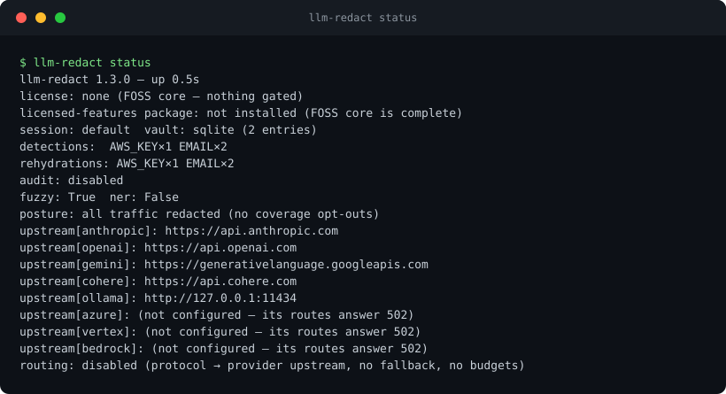

**`/llm-redact:recent`** — the metadata-only recent-request ring buffer
(the one command that fetches an endpoint instead of running the CLI):

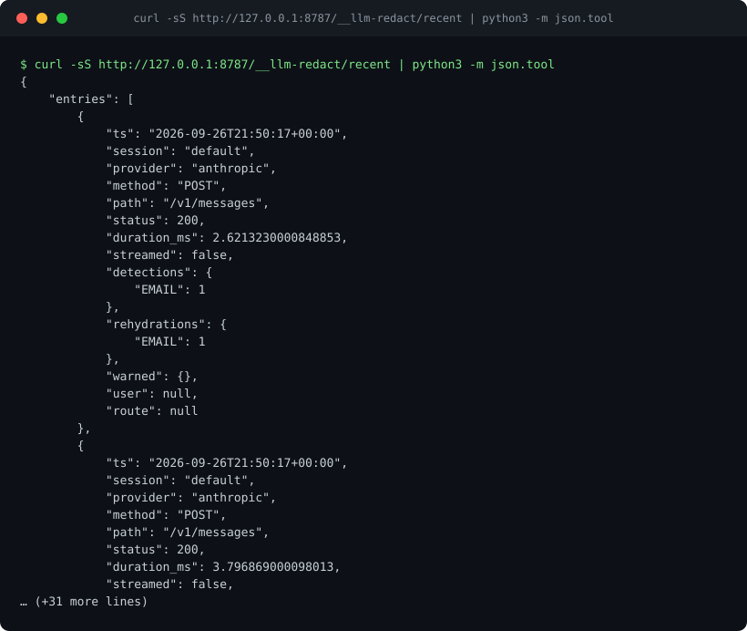

**`/llm-redact:sessions`** — the vault's session list:

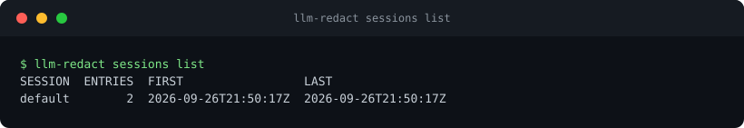

**`/llm-redact:config-show`** — the effective configuration:

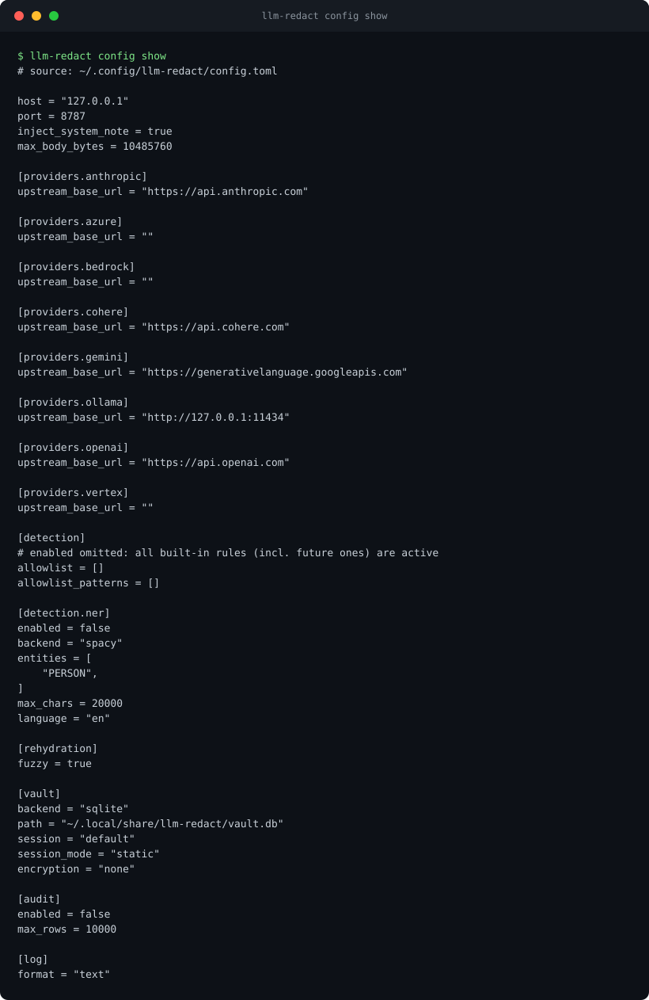

**`/llm-redact:config-edit`** — a guarded config change driven from
inside the agent (what the llm-redact-pro config editor does in the
browser): read the effective config, edit the TOML, gate on
`serve --check`, reload via SIGHUP, and read the coverage posture back.
A session as Claude Code presents it (the agent narration is
illustrative; every command output is the fixture rig's real output,
executed in this order — note the posture read-back catching the
warn-mode opt-out):

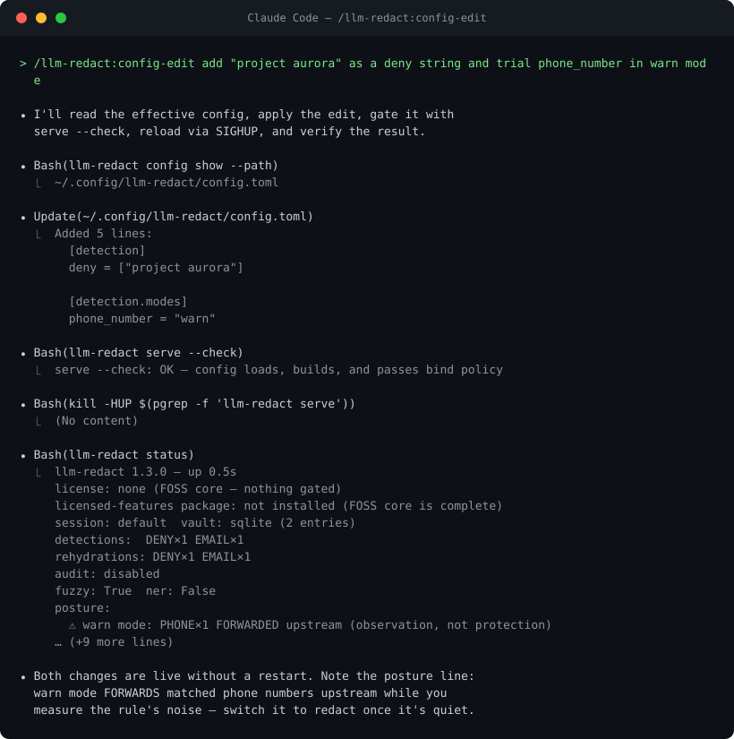

The same workflow reaches every hot-editable setting; three more
sessions, each verified a different way:

*A per-type allowlist — stop redacting one public address without
loosening anything else, proven by the local preview dry-run:*

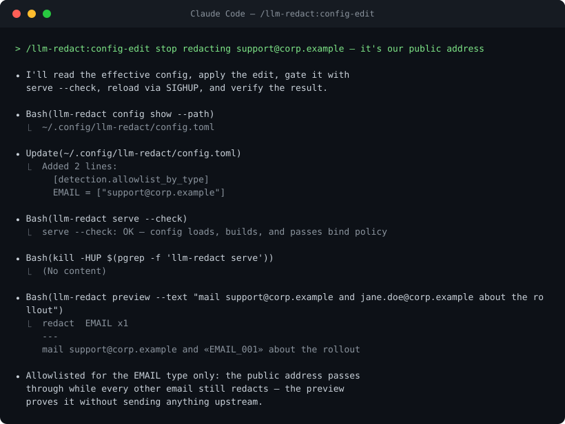

*Block mode — private keys rejected before any upstream contact; the
preview read-back shows the fail-closed 400:*

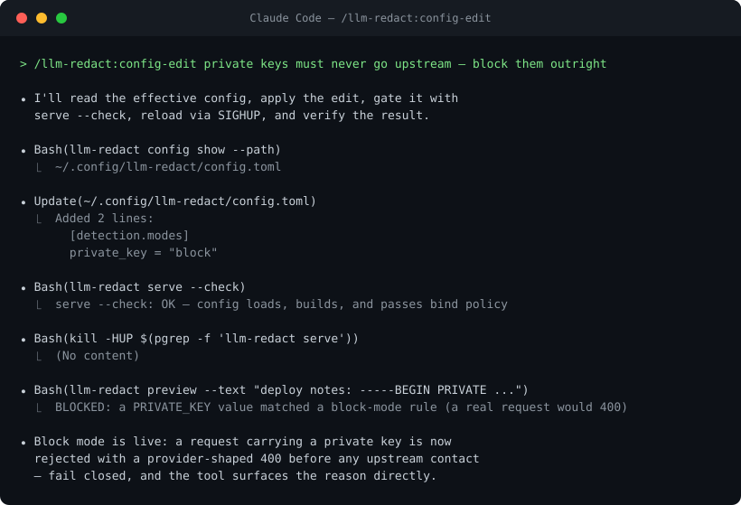

*Language scoping — and the loud posture read-back every opt-out gets:*

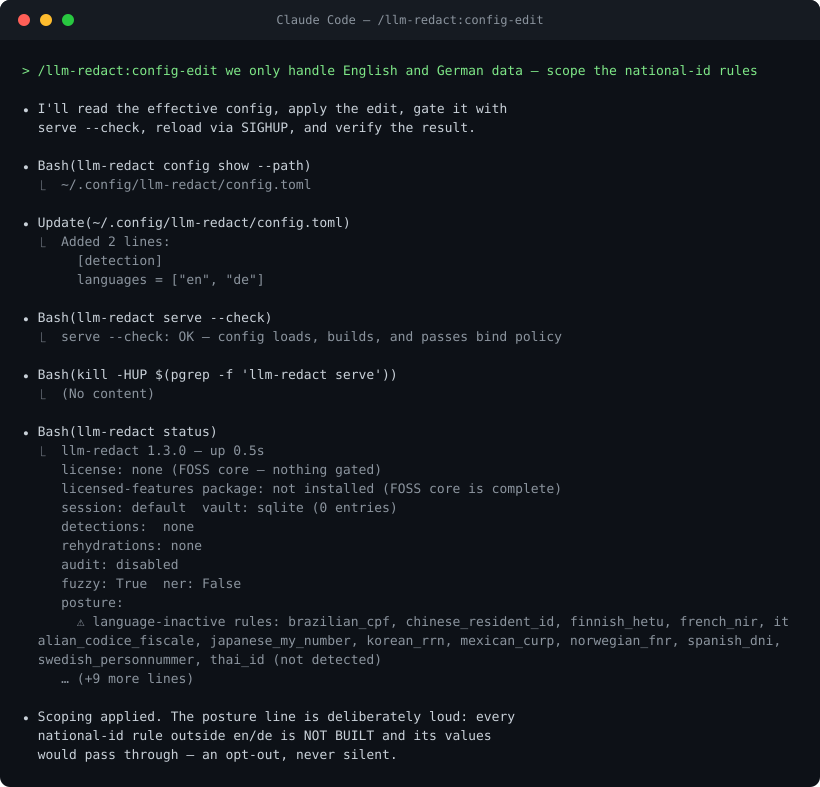

**`/llm-redact:preview`** — the local redaction dry-run:

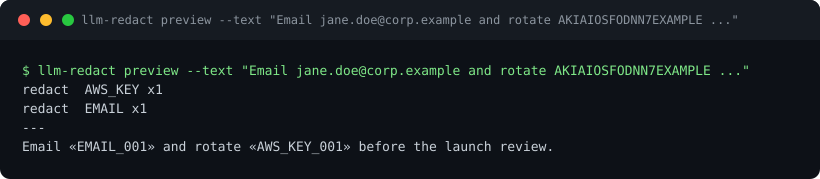

**`/llm-redact:doctor`** — the read-only diagnostics:

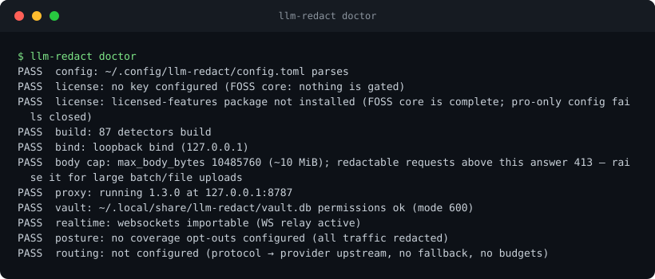

**`/llm-redact:audit`** — the audit log lives in the paid
`llm-redact-pro` package (**coming soon**), so this is the honest
package-absent output; with `llm-redact-pro` installed and `[audit]`
enabled it reports rows checked and the chain verdict:

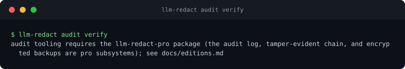

**`/llm-redact:guide`** — the packaged user guide (shot truncated; the
command prints the whole document):

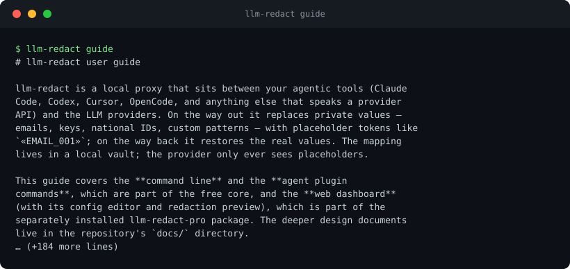

And the installer itself:

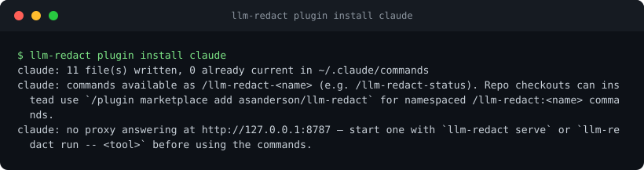

## What is deliberately NOT a command

`llm-redact lookup` resolves placeholders back to their secret VALUES. An
agent that runs it carries the value into its conversation — and the next
request sends that conversation to the provider, which is the exact leak
the proxy exists to prevent. The exclusion is pinned by test
(`tests/test_plugins.py::test_lookup_is_never_a_plugin_command`); run
`lookup` yourself in a terminal when you need it.

## Plugin-first onboarding

A marketplace install can land on a machine that never had the proxy —
the plugin arrives FIRST and the proxy has to catch up. Every command
body opens with a guard written for exactly that order, and the Claude
Code plugin adds a startup posture check. Both are detection-and-offer
only: nothing installs, and nothing claims protection, without your
explicit approval.

### The proxy-presence guard

If the `llm-redact` CLI is not on PATH, the agent must STOP, say so,
and ask which of three pinned setup tiers you want — it never installs
on its own initiative, never improvises install commands, and only ever
uses the package name `llm-redact-proxy` verbatim (agent-invented
install commands are a known supply-chain vector; both directions are
pinned by test):

1. **Try it with nothing installed** — `uvx --from llm-redact-proxy
   llm-redact serve` runs the proxy ephemerally from uv's cache;
   nothing lands on PATH.
2. **Install it** — `uv tool install llm-redact-proxy` (or `pipx
   install llm-redact-proxy`), then `llm-redact init --yes --tools
   <tool>` and `llm-redact service install` for a starter config and
   an always-on proxy. Commands are shown before they run.
3. **Point at an existing proxy** — export `LLM_REDACT_PROXY_URL`;
   the same env var `llm-redact run` and `llm-redact status` honor.

### Routing honesty, per tool

A live proxy is not the same as a routed session, and each tool's guard
states ITS truth rather than a generic reassurance:

| Tool | Routing check | How protection actually starts |
|---|---|---|
| Claude Code | `ANTHROPIC_BASE_URL` points at the proxy | Relaunch via `llm-redact run -- claude` (the base URL is read once at launch — `/reload-plugins` reloads the plugin, not the routing) |
| Codex | `OPENAI_BASE_URL` points at the proxy's `/v1` | Launch via `llm-redact run -- codex` |
| OpenCode | `OPENAI_BASE_URL` points at the proxy's `/v1` | Launch via `llm-redact run -- opencode` |
| Cursor | Custom-API-key mode with the base-URL override in Cursor's settings | Cursor routes AI traffic through its own backend by default — unless you confirm the custom-API-key setup, the guard says plainly that Cursor's conversation traffic is NOT protected |

On the CLI side, `llm-redact plugin install` ends with the same posture
line — whether a proxy is answering right now, and how to start one if
not.

### The SessionStart posture check (Claude Code marketplace install)

The marketplace plugin ships `bin/llm-redact-posture` (a read-only POSIX
sh script, on the Bash tool's PATH while the plugin is enabled) and a
`SessionStart` hook that runs it with `--quiet-ok`. On every session
start, resume, clear, and compact it reports exactly one of four states
— CLI missing, proxy down, proxy up but session unrouted, healthy — and
a healthy routed session injects nothing at all. The unrouted state is
the one this exists for: a running proxy with an unrouted session is the
silent-unprotected state, and the hook makes it loud instead. The script
never installs anything, prefixes every message with its own name (no
unexplained context in your session), and echoes URLs as
scheme://host:port only — a path (which could carry a credential)
embedded in `LLM_REDACT_PROXY_URL` never reaches the transcript. You can also run it
yourself at any time: `llm-redact-posture` (verbose form prints OK).

The copy-install path (`llm-redact plugin install claude`) carries the
commands only — personal commands have no `bin/` or hooks, so the
posture check rides the marketplace plugin alone.

For OpenCode, a native JS plugin (its `event` hook on `session.created`
could run the same posture check) is a documented future option; today
OpenCode gets the same guard-in-body protection as Codex.

The command bodies never widen what leaves the machine: status, recent,
sessions, and audit are metadata-only surfaces by design, and preview
returns your own text already masked.

## Scan sinks (a registry seam)

> **A scan sink receives UNREDACTED text.** It is handed the strings a
> request's redaction scanned exactly as the client sent them — the API
> keys, emails, names and ID numbers the proxy exists to keep from the
> provider. Install a plugin that registers one only when you trust it
> with that text as you trust the proxy itself: what it keeps is outside
> the vault's protections, and storing, encrypting, retaining and purging
> it is the plugin's job. The Free core registers no sink.

This is not an agent plugin: it is a seam of the proxy process, for a
Python package like llm-redact-pro (whose opt-in training capture it was
added for). `Registry.build_scan_sinks(config, tier)` returns the sinks,
once at startup (restart-only); the contract is `plugin_api.ScanSink`,
whose three members are synchronous (a sink declaring one `async def` is
refused at startup):

- `wants(context) -> bool` is asked synchronously, on the event loop,
  before each request's (or realtime client frame's) redaction — a flag,
  a sample, a clock; never I/O. Only `True` captures it.
- `capture(context, strings)` is called for a request a sink wanted, once
  its redaction succeeded and the request is handed to its upstream (a
  realtime frame: right before it is sent). `strings` holds each DISTINCT
  string the redaction scanned, once, in the order first scanned
  (`ScannedString.text`), with every detection found in it
  (`ScannedDetection`: type, start, end, and the detector — `kind` `rule`,
  `custom`, `deny`, `ner` or `other`, `source` the rule's name or the NER
  backend's as configured — `spacy`, `hf`, `gliner`, … as `/status`
  `detection.ner.backends` names them), after the allowlists and before
  overlap resolution and modes.
  `context` (`ScanContext`) carries the surface (`http` or `websocket`),
  provider, adapter, method, path, vault session, the access gate's
  subject and whether a credential the proxy holds is spent — never a
  value. Never a placeholder or vault data.
- `close()` once at shutdown, after the queue drained.

What is captured: JSON body strings, verbatim and label fields, an
upload's form fields, file names, text and JSONL file parts, text an
upload inspector extracted from a binary part, a convert-mode document's
text, realtime client frames. What is not: a request refused at any point
(a block, an access gate's check, the `[audit] required` START row, an
upstream authorizer, a routing budget), and anything the core forwards
without scanning it (`[providers.NAME] detection = false`, pass-through
routes, an exempt MCP server's blocks, the MCP connector configuration —
`mcp_servers`, `tools` of type `mcp`, with their credentials — a binary
part sent unscanned, the structural values the redaction skips such as a
`model` or base64 data) or adds itself (the system note).

`capture` runs on ONE worker thread, never on the event loop and never two
calls at once (not always the same thread: the worker exits after 5 s
idle and a new one starts with the next capture), in the order requests
were handed upstream. The queue in front of it holds at most 256
captures, 16 Mi characters and 256 Ki strings plus detections (each held
as an object of its own, which costs far more memory than a short
string's characters): a capture that does not fit is dropped and
counted, never waited for, so a slow sink loses captures rather than
slowing any request (the worker is a thread of the proxy's process: a
sink that computes much competes with the event loop for the
interpreter, so hand heavy work to another process). A sink's exception
— a `BaseException` such as `SystemExit` included — is contained, counted
(`llm_redact_bookkeeping_errors_total{stage="scan_sink"}`) and logged by
its type only, once per outage. At shutdown the queue drains for at most
5 s beside the vault's map-write drain (the shutdown budget is unchanged;
[resilience.md](resilience.md#shutdown-order)), what is left is dropped
and counted, and each sink is closed once — never while a capture still
runs: when one is still running as the 5 s run out, no sink is closed.

`/status` `scan_capture` reports `sinks`, `queued`, `delivered_total` (one
for each sink a capture reached), `dropped_total`, `dropped_by_reason` (the
queue bound a dropped capture would have passed — `captures`, `characters`,
`items` — or `shutdown`) and `faults_total`, and `llm-redact status` prints a
posture line while any sink is registered. While a sink is registered,
`/metrics` serves the same as `llm_redact_scan_captures_delivered_total`,
`llm_redact_scan_captures_dropped_total{reason}` and
`llm_redact_scan_capture_queue_depth`
([observability.md](observability.md#metrics-reference); the
`LlmRedactScanCapturesDropped` alert warns when the queue keeps dropping, and the shipped
Grafana dashboard's Scan sinks row charts all three). The threat model's
[Scan sinks](threat-model.md#scan-sinks-a-plugin-reading-what-the-redaction-scanned)
section states what the core does and does not guarantee.

## The dashboard host (a registry seam)

A plugin's browser dashboard (`Registry.build_dashboard`, llm-redact-pro's
page, config editor and redaction preview) receives only the core's fixed
dashboard paths and calls back into the proxy through
`plugin_api.DashboardHost`, which the proxy's state satisfies: the live
config, the request guards, `validate_config(candidate)` (the dry run of
everything an apply builds, raising and changing nothing),
`apply_config(fresh)` (the SIGHUP hot-apply path) and `preview(text)` (the
live detection pipeline over a sample text on a throwaway vault).

A preview runs an NER model over the text and a check of a changed
`[detection]` loads every NER model, so a dashboard runs both on a worker
thread of its own, never on the event loop that serves every request. Three
optional members (read them with `getattr`: a core before 1.13 lacks them)
make that safe and cheap:

- `preview_snapshot` (True): the detectors, allowlists and modes are ONE
  immutable snapshot that an apply swaps in a single assignment, and
  `preview` reads it once — a preview an apply overlaps describes the
  configuration that was live when it began, never a mix of two. (Without
  it, a preview may have read the old detectors with the new modes; such a
  run must be repeated.)
- `prepare_config(candidate)`: `validate_config`'s checks, raising the same
  errors, that keeps the detection objects it built for a changed
  `[detection]` (every NER model loaded) in an opaque
  `plugin_api.PreparedConfig`. Safe on a worker thread: it changes nothing
  on the proxy and never touches the event loop. `validate_config` is
  `prepare_config` followed by `close()`.
- `apply_config(fresh, prepared=...)`: hand the prepared build to the
  apply, on the event loop, and its detection objects are adopted instead
  of being built a second time there — a save loads each NER model once,
  off the loop. They are adopted only when they were prepared for a
  `[detection]` equal to the one the apply builds (the saved one, with any
  restart-only part kept from the running configuration) and no apply that
  changed `[detection]` (a SIGHUP reload, another save) landed since;
  otherwise the apply builds as it would without them. The apply spends the prepared build either way; close one
  you do not apply (closing twice is harmless).

A SIGHUP reload is unchanged: it builds on the event loop.

## For contributors

Edit `src/llm_redact/plugin_assets.py`, then re-render the checked-in
Claude Code plugin and marketplace manifest:

```bash
uv run python scripts/render_plugins.py
```

`tests/test_plugins.py` pins the rendered files to the module in both
directions (stale content or stray files fail CI), keeps every
`llm-redact` invocation inside command bodies pointing at a real CLI
subcommand, and enforces the lookup exclusion.
